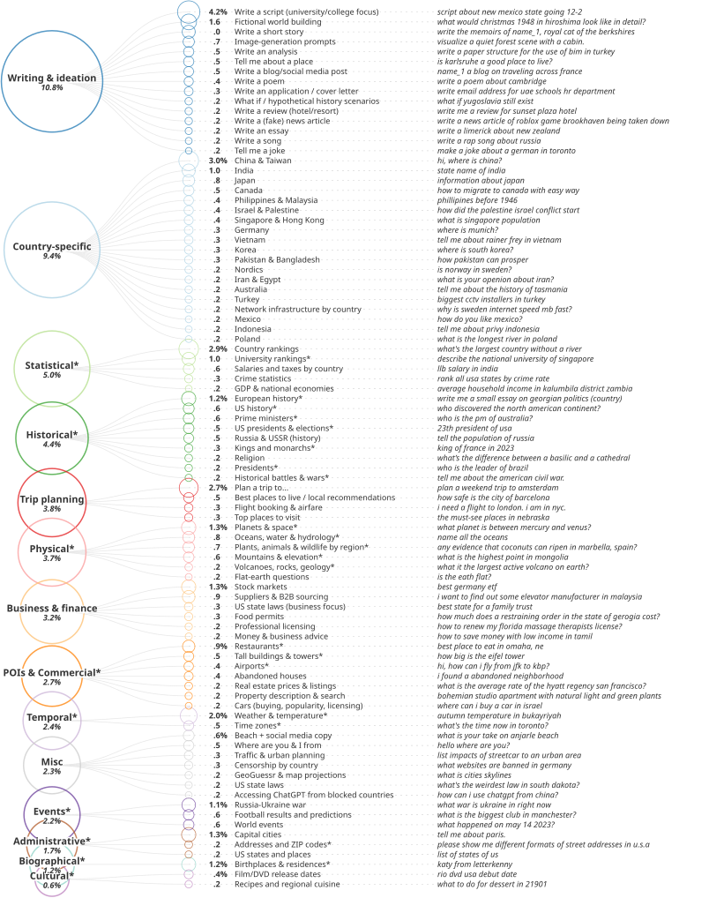
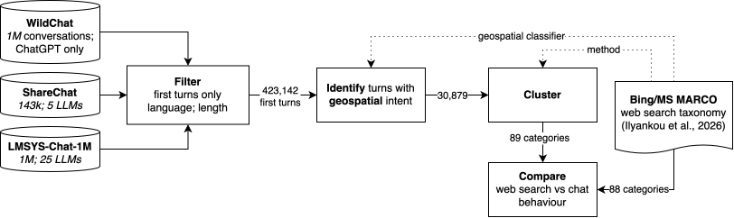

# Conversational Interfaces Reshape What People Ask of Place

Code and taxonomy for our BritCHI 2026 paper: **"Conversational Interfaces Reshape What People Ask of Place"** (Ilyankou, Cavazzi & Haworth, 2026).

We reuse the geospatial classifier and clustering pipeline from our prior study of Bing search queries (*Much of Geospatial Web Search Is Beyond Traditional GIS*: [arXiv](https://arxiv.org/abs/2605.11336v1), [GitHub](https://github.com/ilyankou/ms-marco-geospatial)) and apply it to 423,142 short, first-turn, English-language chatbot prompts drawn from three public corpora — [WildChat](https://arxiv.org/abs/2405.01470), [ShareChat](https://arxiv.org/abs/2512.17843), and [LMSYS-Chat-1M](https://arxiv.org/abs/2309.11998) — to see how expressed geospatial needs differ between a keyword search bar and a conversational interface.

We find that the factual-lookup core persists (people still ask chatbots for capitals, distances, and boundaries), but the largest new behaviour, **Writing & ideation** (place-grounded text composition), has no counterpart in keyword search, and **Trip planning** shifts from narrow "when to go" questions to itinerary-scale, multi-constraint requests.



## Pipeline



The notebooks run in numbered order:

| Notebook | Purpose |
|---|---|
| [1a-CleanUpWildChat.ipynb](1a-CleanUpWildChat.ipynb) | Load WildChat, keep English first turns ≤131 characters, dedupe |
| [1b-CleanUpShareChat.ipynb](1b-CleanUpShareChat.ipynb) | Load and clean ShareChat |
| [1c-CleanUpLMSYSChat.ipynb](1c-CleanUpLMSYSChat.ipynb) | Load and clean LMSYS-Chat-1M |
| [2-IdentifyAndClusterGeospatial.ipynb](2-IdentifyAndClusterGeospatial.ipynb) | Merge the three corpora, remove templated artefact prompts, classify geospatial intent with [`ilyankou/is-geospatial-query`](https://huggingface.co/ilyankou/is-geospatial-query), grid-search UMAP + HDBSCAN, and label clusters |
| [3-Visualise.ipynb](3-Visualise.ipynb) | Build the theme/category taxonomy figure |
| [CompareSearchVsChat.ipynb](CompareSearchVsChat.ipynb) | Compare the resulting chat taxonomy against the Bing/MS MARCO taxonomy |
| [LookUpFirstTurns.ipynb](LookUpFirstTurns.ipynb) | Inspect sample prompts within a given cluster/category |

The 131-character cap matches the 99.9th percentile of MS MARCO query length so the same classifier (fine-tuned on web search queries) applies reliably, and enables a like-for-like comparison with the prior search taxonomy.

Clustering uses the same method as the prior Bing study: `BAAI/bge-small-en-v1.5` sentence embeddings → UMAP dimensionality reduction → HDBSCAN density-based clustering, with parameters chosen by grid search and a DBCV-based stability check across random seeds.

## Data

Raw datasets (WildChat, LMSYS-Chat-1M, ShareChat parquet/CSV files in `wildchat-1m/`, `lmsys-chat-1m/`, and `sharechat/`) are not tracked in git — download them from the links above into those folders before running notebook 1a/1b/1c. Intermediate outputs (filtered/deduplicated first turns, classifier evaluation samples, clustering grid-search results, cluster review sheets) are written to `interim/`; final review artefacts and figures are written to `output/` and `visual/`.

## Citation

If you use this code or taxonomy, please cite:

```bibtex
@inproceedings{ilyankou2026conversational,
  title     = {Conversational Interfaces Reshape What People Ask of Place},
  author    = {Ilyankou, Ilya and Cavazzi, Stefano and Haworth, James},
  booktitle = {Proceedings of BCS BritCHI 2026},
  year      = {2026},
  publisher = {BCS Learning and Development Ltd.}
}
```

## Acknowledgements

This work was supported by Ordnance Survey & UKRI Engineering and Physical Sciences Research Council [grant no. EP/Y528651/1].
